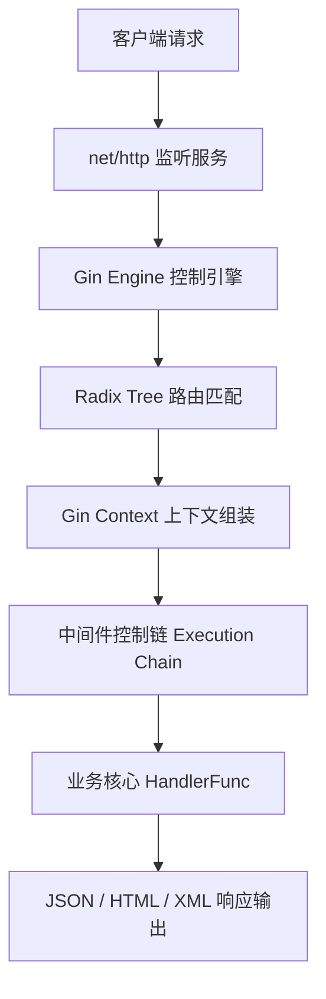

在 Go 语言的技术版图中，Web 框架的选择数不胜数：从高度抽象、开箱即用的 Beego，到追求极致简练的原生 `net/http`。然而在企业级开发中，**Gin** 凭借着在**高性能**与**开发效率**之间的完美平衡，常年稳居 Go Web 开发者的首选王座。

它被戏称为让开发者实现 **Work-Life Balance (工作与生活平衡)** 的框架——因为用它开发不仅开发速度飞快，而且极易维护、排查，线上运行极其平稳，几乎从不需要加班应对突发 Bug。

本文我们将深度拆解 Gin 框架的核心设计，从底层路由（Radix Tree）到中间件控制链，一窥其精妙的源码设计架构。

---

## 1. Gin 架构概览

Gin 采用模块化与微核心（Micro-Kernel）设计，它的整体处理流程极其流畅：



正如上图所示，一个请求从进来，到经过路由分发、中间件过滤、Context 包装，最终再流向业务逻辑，整个流水线不仅极其清晰，而且各环节高度解耦。

---

## 2. 核心架构之源：Radix Tree（基数树）路由

Gin 的超高性能，很大程度上得益于其底层采用的 **Radix Tree (基数树)** 路由检索算法。这是一种多叉搜索树，特别适合用来处理以 `/` 分隔的 URL 路径匹配。

与原生的以 Map 为主体的路由匹配或者正则匹配相比，Radix Tree 具有以下无与伦比的优势：

- **公共前缀共享**：例如对于路由 `/api/v1/user` 和 `/api/v1/order`，Radix Tree 会共享前缀 `/api/v1/`。这不仅极大缩减了内存占用，更将路由匹配的查找时间复杂度降到了常数级别的 $O(K)$（K 为路径长度），与路由条数的多少毫无关系！
- **零动态内存分配**：在匹配路径时，Gin 做到了接近 **0-allocation**，避免了大量小对象分配对垃圾回收（GC）造成的抖动压力。

### 源码实现视角：路由节点的定义

在 Gin 底层源码中，每一个 HTTP 请求方法（GET, POST 等）都独立拥有一棵基数树的 `node` 节点：

```go
type node struct {
    path      string        // 当前节点共享的前缀路径
    indices   string        // 子节点的索引字符集，用于快速分叉查找
    children  []*node       // 子节点切片
    handlers  HandlersChain // 匹配该路由节点所需要执行的中间件和处理器链
    wildChild bool          // 是否为通配符路由节点（如 :id, *filepath）
}
```

当请求到达时，算法仅需根据子路径的字符在 `indices` 中查找对应的索引并跳入 `children` 即可，效率极其惊人。

---

## 3. 优雅的生命周期守护者：Gin.Context

在处理并发请求时，Go 官方推荐利用 `context.Context` 传递跨生命周期的上下文变量。然而，Gin 创造性地定义了自己的核心类 **`gin.Context`**。

它不仅是对原生 `http.ResponseWriter` 和 `*http.Request` 的完美封装，更是串联路由参数、表单校验、Session 绑定和状态码响应的集大成者：

```go
type Context struct {
    writermem responseWriter
    Request   *http.Request
    Writer    ResponseWriter

    Params   Params
    handlers HandlersChain
    index    int8
    fullPath string

    Keys map[string]any
    // ... 其他底层管理变量
}
```

### Context 的池化设计 (Pooling)

在高并发的极端场景下，每个请求都高频创建与销毁 `gin.Context` 结构体仍然是一笔不小的内存开销。
为了压榨极致性能，Gin 巧妙地引入了 `sync.Pool` 对象池：

```go
func (engine *Engine) ServeHTTP(w http.ResponseWriter, req *http.Request) {
    // 从 sync.Pool 中复用 Context
    c := engine.pool.Get().(*Context)
    c.writermem.reset(w)
    c.Request = req
    c.reset()

    // 执行中间件与核心业务逻辑
    engine.handleHTTPRequest(c)

    // 执行完毕，重置并放回 sync.Pool
    engine.pool.Put(c)
}
```

通过这一绝妙的池化设计，Gin 大幅减轻了高频堆内存申请的负担，有效降低了系统的 GC 耗时，确保了系统能平稳运行在高并发状态下。

---

## 4. Work-Life Balance 的救星：中间件控制链

Gin 让开发者感到最舒适的，莫过于其极其强大的**链式中间件机制（Middleware Chain）**。它是通过类似洋葱模型的过滤器机制实现的，且实现原理极其巧妙。

在 `gin.Context` 中，有两个起决定性作用的属性：
- `handlers HandlersChain`：一个由所有的中间件函数和最终的业务逻辑处理函数（`HandlerFunc`）组成的顺序切片。
- `index int8`：当前正在执行的中间件索引。

### `c.Next()` 的核心源码艺术

当我们在中间件中调用 `c.Next()` 时，Gin 是如何驱动后面的中间件或核心逻辑执行的呢？答案非常简练：

```go
func (c *Context) Next() {
    c.index++
    for c.index < int8(len(c.handlers)) {
        c.handlers[c.index](c)
        c.index++
    }
}
```

这就是纯粹的函数迭代艺术！
1. 如果你没有调用 `c.Next()`，Gin 也会在此函数返回后，由外层的循环自动驱动执行下一个 Handler。
2. 如果你在中间件中调用了 `c.Next()`，它会主动提前跳入后续的 Handler 执行；当后续的所有 Handler 执行完毕返回后，程序会继续回到当前中间件 `c.Next()` 之后的行往下执行（经典的洋葱模型回溯！）。

例如，一个极简的计算耗时的中间件仅需 4 行代码：

```go
func CostTimeMiddleware() gin.HandlerFunc {
    return func(c *gin.Context) {
        start := time.Now()
        
        c.Next() // 触发执行后续的所有业务 Handler

        // 回溯阶段：此时后续逻辑已全部执行完成
        cost := time.Since(start)
        log.Printf("Request to %s cost: %v", c.Request.URL.Path, cost)
    }
}
```

有了这种极度清晰的生命周期控制，无论是统一进行 JWT 验签、全局 Panic 拦截与错误恢复（`gin.Recovery()`）、还是接口的流控限速，开发者都能在瞬息之间组装完毕，保证了开发过程中的高产出与零疲劳。

---

## 5. 总结

Gin 并不是追求极致炫技的学术框架，它是一把在工业级战场上被深度打磨得无比顺手的**工程尖刀**。
优秀的性能来自于 Radix Tree 与 Context 对象的池化复用；而超凡的生产力则来源于开箱即用、逻辑自洽的中间件和上下文生命周期设计。

选择 Gin 构建您的后端服务，将开发工作化繁为简，助您早日写出优雅的 Go 代码，享受完美的 **Work-Life Balance**！
